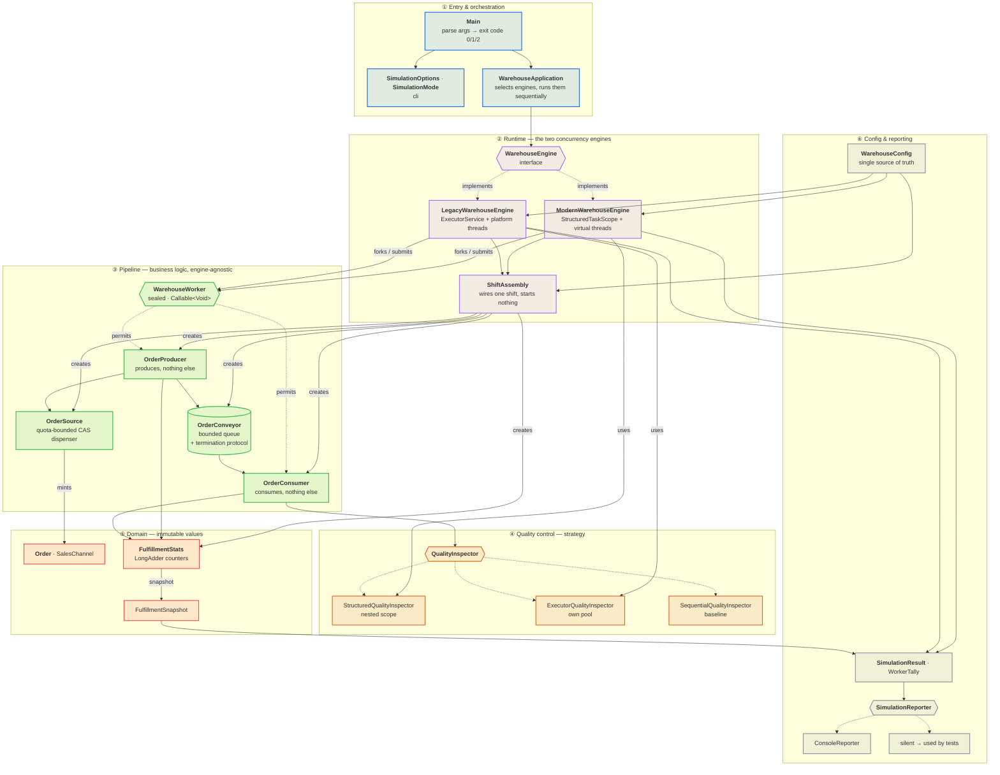
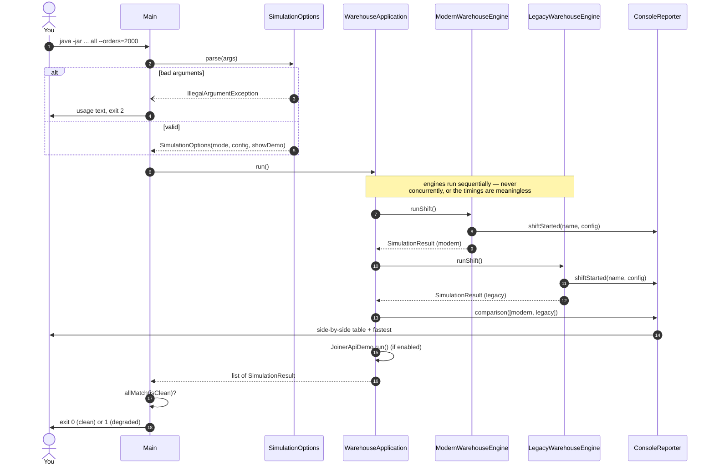
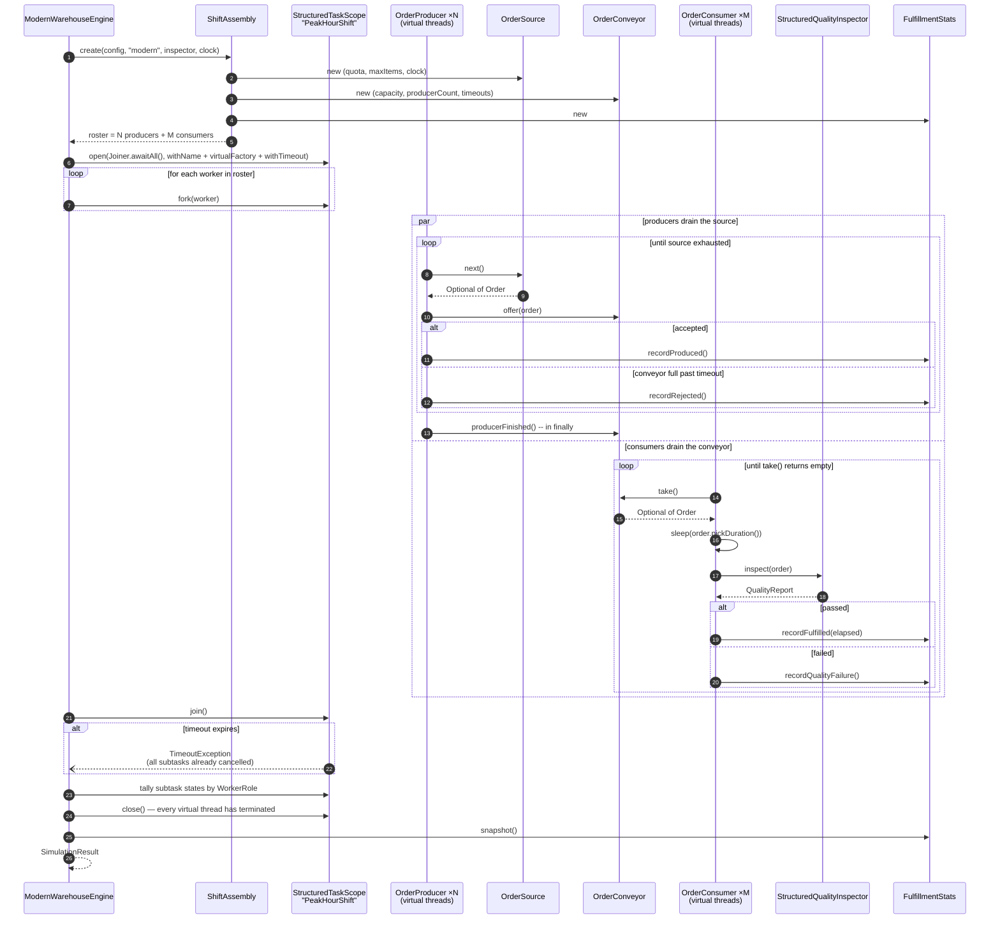
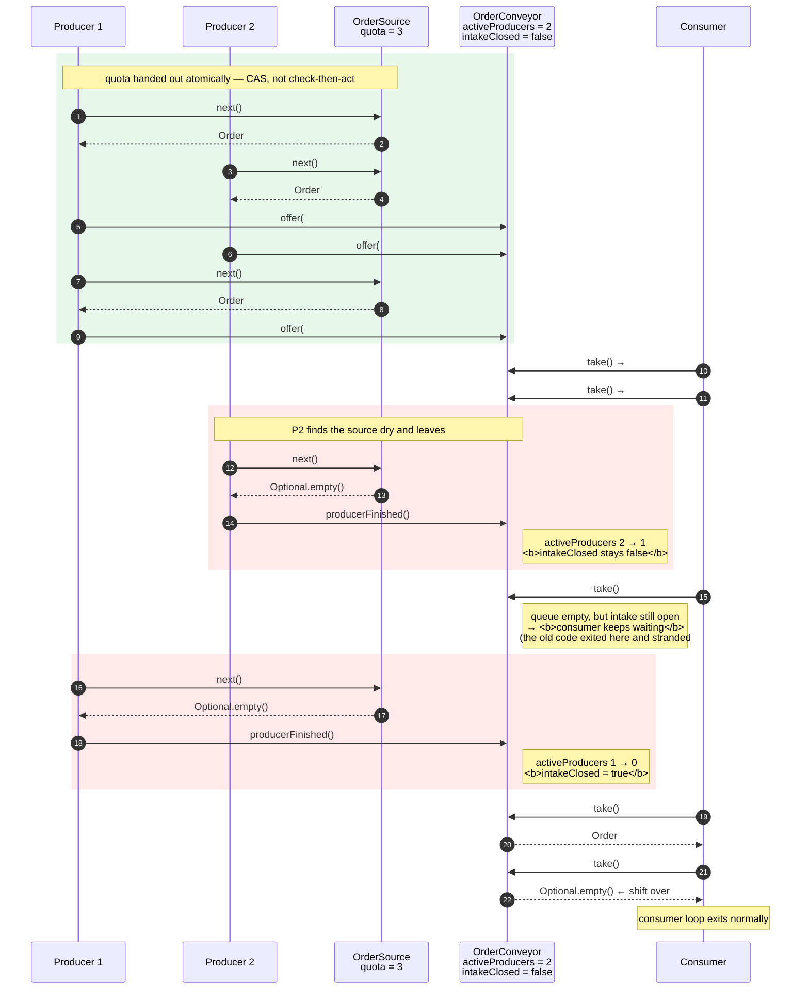
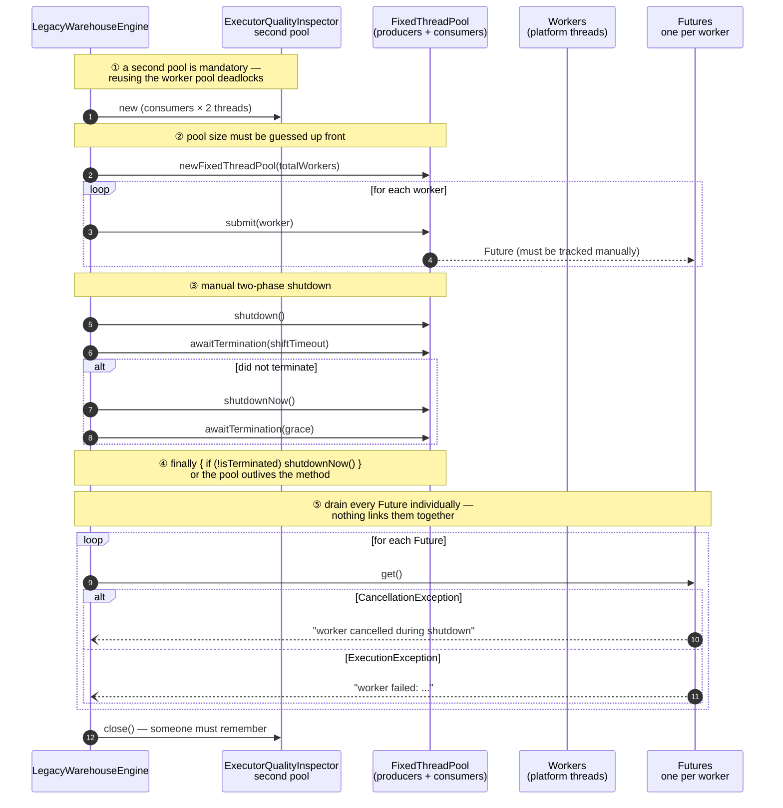
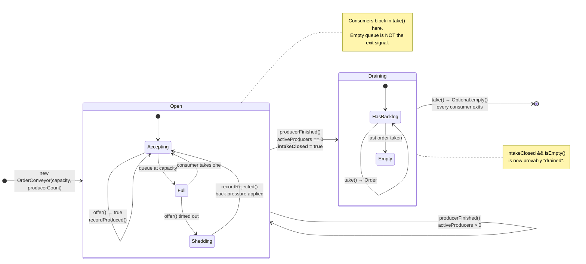
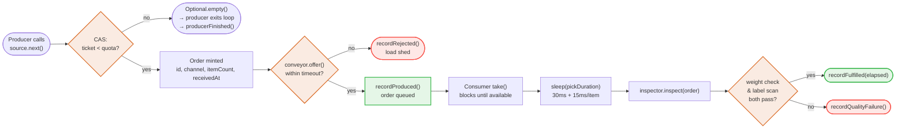
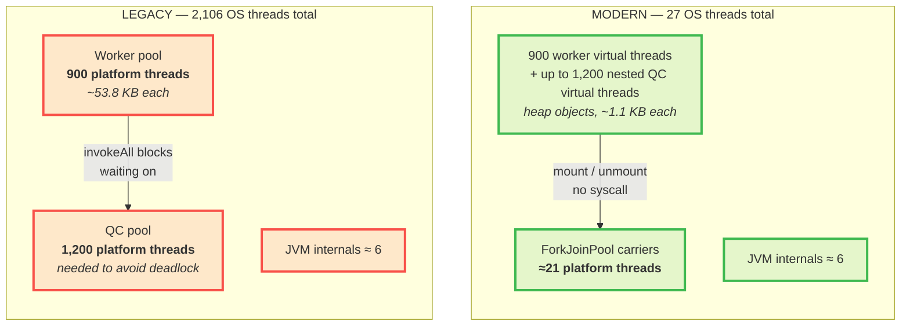

# Smart Warehouse — Concurrency Comparison

A producer/consumer simulation that runs the **same workload** under two concurrency models so the
difference between them is measurable rather than theoretical:

| Engine     | Scheduling                                     | Nested work                  |
|------------|------------------------------------------------|------------------------------|
| **Legacy** | `ExecutorService` + fixed pool of platform threads | second dedicated pool        |
| **Modern** | Virtual threads in a `StructuredTaskScope` (JDK 26 preview) | nested child scope |

Requires **JDK 26** (`StructuredTaskScope` is still a preview API).

> 📊 **[docs/CONCURRENCY-COMPARISON.md](docs/CONCURRENCY-COMPARISON.md)** — a detailed, fully
> measured comparison of the two models: memory, resource utilisation, CPU cost, scalability limits,
> ease of use, failure modes and when *not* to use virtual threads. Headline results:
>
> | Identical workload, 900 workers | Legacy | Modern |
> |---|---:|---:|
> | Peak OS threads | 2,106 | **27** (78× fewer) |
> | Peak RSS | 254.9 MB | **95.3 MB** (2.7× less) |
> | CPU cycles for the same instructions | 9.70 B | **3.22 B** (3.0× fewer) |
> | At 2,500 workers | 💥 `OutOfMemoryError: unable to create native thread` | ✅ 12,295 orders/s |

> ✍️ **[docs/medium-article.md](docs/medium-article.md)** — the narrative write-up of the same
> material, aimed at a general Java audience: the four concurrency bugs the refactor exposed, the
> benchmark results, and why the thread-starvation deadlock is the argument that matters most.

---

## Running

```bash
mvn clean verify                       # compile + 48 tests
mvn -q compile exec:exec               # run both engines with defaults
mvn -q compile exec:exec -Dsim.args="modern --orders=500"

mvn -q -DskipTests package
java --enable-preview -jar target/java-learning.jar all --orders=2000 \
     --producers=300 --consumers=600 --buffer=256 --intake-delay-ms=0
```

Options: `--producers`, `--consumers`, `--buffer`, `--orders`, `--intake-delay-ms`,
`--timeout-seconds`, `--no-demo`. Exit code is `0` for a clean shift, `1` if any shift degraded,
`2` for bad usage.

### Benchmarks

Two reproducible probes back every number in the comparison document. Run each in its own JVM and
wrap it in `/usr/bin/time -l` (macOS) or `/usr/bin/time -v` (Linux) to capture peak RSS — a platform
thread's stack is *native* memory that never shows up in heap statistics.

```bash
# What does a thread cost?   <platform|virtual> <count>
/usr/bin/time -l java --enable-preview -cp target/classes \
    com.java.learning.bench.ThreadFootprintBenchmark platform 5000

/usr/bin/time -l java --enable-preview -Xmx4g -cp target/classes \
    com.java.learning.bench.ThreadFootprintBenchmark virtual 1000000

# Find your machine's platform-thread ceiling (this one dies on purpose)
java --enable-preview -cp target/classes \
    com.java.learning.bench.ThreadFootprintBenchmark platform 20000

# What did a shift cost?     <modern|legacy> [producers] [consumers] [orders]
for e in modern legacy; do
  /usr/bin/time -l java --enable-preview -cp target/classes \
      com.java.learning.bench.EngineFootprintBenchmark $e 300 600 2000
done
```

---

## How it works

Nine views of the same system, from "what are the pieces" down to "what happens to a single order".
All diagrams render natively on GitHub.

**If you're reading this for the first time**, go in this order:

| # | Diagram | Answers |
|---|---------|---------|
| 1 | [Component](#1-component-diagram--the-layers) | What are the pieces and which way do dependencies point? |
| 2 | [Knowledge graph](#2-knowledge-graph--who-knows-whom) | Who talks to whom, and with what verb? |
| 3 | [Top-level sequence](#3-sequence--the-top-level-run) | What happens from `main()` to exit code? |
| 4 | [Modern shift](#4-sequence--inside-one-modern-shift) | **The core flow** — how work actually gets done |
| 5 | [Termination protocol](#5-sequence--the-termination-protocol) | How does a shift end without stranding an order? |
| 6 | [Legacy lifecycle](#6-sequence--legacy-lifecycle-for-contrast) | What does the pool model cost you? |
| 7 | [Conveyor states](#7-state-diagram--the-conveyor) | When is the queue open, full, draining, done? |
| 8 | [One order](#8-one-order-end-to-end) | The full journey of a single `Order` |
| 9 | [Thread footprint](#9-where-the-threads-actually-go) | Where do 2,106 vs 27 OS threads come from? |

### 1. Component diagram — the layers

Dependencies point **downwards only**. The pipeline (the actual business logic) sits in the middle
and knows nothing about the engines above it — that inversion is what lets both engines run the
identical workers.



> **Read the two purple boxes as interchangeable.** `ModernWarehouseEngine` and
> `LegacyWarehouseEngine` both consume the green pipeline unchanged. Swapping them swaps the
> concurrency model and nothing else.

### 2. Knowledge graph — who knows whom

Every edge is a real relationship in the code, labelled with the verb it actually performs.

```mermaid
graph LR
    CFG(["WarehouseConfig"])
    ASM(["ShiftAssembly"])
    SRC(["OrderSource"])
    ORD(["Order"])
    CH(["SalesChannel"])
    PRD(["OrderProducer"])
    CNV(["OrderConveyor"])
    CNS(["OrderConsumer"])
    QCI(["QualityInspector"])
    QCR(["QualityReport"])
    STA(["FulfillmentStats"])
    SNP(["FulfillmentSnapshot"])
    WRK(["WarehouseWorker"])
    ROLE(["WorkerRole"])
    ENG(["WarehouseEngine"])
    RES(["SimulationResult"])
    TAL(["WorkerTally"])
    REP(["SimulationReporter"])

    CFG -->|"parameterises"| ASM
    ASM -->|"creates"| SRC
    ASM -->|"creates"| CNV
    ASM -->|"creates"| STA
    ASM -->|"builds roster of"| WRK
    ENG -->|"schedules"| WRK
    WRK -->|"is a"| PRD
    WRK -->|"is a"| CNS
    WRK -->|"declares"| ROLE
    PRD -->|"claims order from"| SRC
    SRC -->|"mints"| ORD
    ORD -->|"tagged with"| CH
    PRD -->|"offers to"| CNV
    CNV -->|"hands order to"| CNS
    PRD -->|"signals done to"| CNV
    CNS -->|"delegates checks to"| QCI
    QCI -->|"returns"| QCR
    QCR -->|"decides counter"| STA
    PRD -->|"records into"| STA
    CNS -->|"records into"| STA
    STA -->|"snapshots as"| SNP
    ENG -->|"returns"| RES
    SNP -->|"embedded in"| RES
    TAL -->|"embedded in"| RES
    ROLE -->|"aggregated into"| TAL
    RES -->|"rendered by"| REP

    classDef cfg fill:#8b949e22,stroke:#8b949e
    classDef flow fill:#3fb95022,stroke:#3fb950,stroke-width:2px
    classDef val fill:#f8514922,stroke:#f85149
    classDef meta fill:#a371f722,stroke:#a371f7

    class CFG,ASM cfg
    class SRC,PRD,CNV,CNS,QCI flow
    class ORD,CH,QCR,STA,SNP,RES,TAL val
    class WRK,ROLE,ENG,REP meta
```



### 3. Sequence — the top-level run

What happens from `main()` to exit code.



### 4. Sequence — inside one modern shift

This is the core flow. Note what **isn't** here: no pool sizing, no supervisor loop, no shutdown
sequence.



### 5. Sequence — the termination protocol

The subtlest part of the system, and where the original code had a race. Two producers, one
consumer, no supervisor thread anywhere.



> **The invariant:** intake closes *only* when the last producer has finished, and a producer signals
> that strictly after its final `offer()` returns. So once `intakeClosed` is observed,
> `intakeClosed && queue.isEmpty()` provably means *drained*. `OrderProducer` calls
> `producerFinished()` from a `finally` block, so this holds even under cancellation.

### 6. Sequence — legacy lifecycle, for contrast

Same workers, same pipeline. Everything extra here is the cost of the pool model.



### 7. State diagram — the conveyor



### 8. One order, end to end



### 9. Where the threads actually go

The same 900 workers, two very different resource footprints — this is the whole point of the
project, drawn.



Both columns run the **same 2,100 concurrent activities**. Only the cost differs.

| | Modern | Legacy |
|---|---:|---:|
| Concurrent activities | 2,100 | 2,100 |
| **OS threads** | **27** | **2,106** |
| Peak RSS | 95.3 MB | 254.9 MB |
| CPU cycles (same instructions) | 3.22 B | 9.70 B |

---

## Package layout — where to find things

```
cli/        SimulationMode, SimulationOptions      argument parsing
app/        WarehouseApplication                   orchestration
config/     WarehouseConfig                        single source of tuning parameters
domain/     Order, SalesChannel,                   immutable values + metrics
            FulfillmentStats, FulfillmentSnapshot
pipeline/   OrderSource                            quota-bounded order factory
            OrderConveyor                          bounded channel + termination protocol
            OrderProducer                          <-- produces, nothing else
            OrderConsumer                          <-- consumes, nothing else
            WarehouseWorker, WorkerRole            sealed worker abstraction
   qc/      QualityInspector + 3 strategies        sequential / executor / structured
runtime/    WarehouseEngine, ShiftAssembly,        engine SPI + wiring + results
            SimulationResult, WorkerTally
   legacy/  LegacyWarehouseEngine                  ExecutorService model
   modern/  ModernWarehouseEngine                  StructuredTaskScope model
report/     SimulationReporter, ConsoleReporter    presentation (injectable/silenceable)
demo/       JoinerApiDemo                          Joiner policy showcase
bench/      ThreadFootprintBenchmark               what a thread costs
            EngineFootprintBenchmark               what a shift costs
```

The key idea: **producers and consumers know nothing about how they are scheduled.** The identical
`WarehouseWorker` instances are handed to an `ExecutorService` by one engine and forked into a
`StructuredTaskScope` by the other, so any measured difference is attributable to the concurrency
model — not to divergent business logic.

---

## What the refactor fixed

### Correctness

| # | Defect in the original | Fix |
|---|------------------------|-----|
| 1 | **Quota overshoot.** Every producer ran `while (intakeOpen && stats.produced() < QUOTA)` — a check-then-act race, so N producers could all pass the check and overshoot by up to `N-1`. | `OrderSource.next()` fuses the quota check and sequence increment into one CAS. The quota is now exact. |
| 2 | **Torn read in the legacy producer.** `orderSequence.incrementAndGet()` for the id, then `orderSequence.get()` again for the item count — a different value by then. | The order is built from a single claimed ticket. |
| 3 | **Racy termination.** A supervisor flipped `intakeOpen` while producers were mid-`put()`, so a consumer could see `!intakeOpen && isEmpty()` and exit while an order was still in flight. | `OrderConveyor` closes intake *only* after the last producer has provably finished, making `closed && isEmpty()` a sound "drained" test. |
| 4 | **Stranded consumers on cancellation.** A cancelled producer never signalled that it had stopped. | `OrderProducer` calls `conveyor.producerFinished()` from a `finally` block, so cancellation still releases every consumer. |
| 5 | **Unbounded `put()`.** If all consumers died, producers blocked forever; only the shift timeout broke it. | Timed `offer()` sheds load and records a rejection instead of deadlocking. |
| 6 | **Shared non-thread-safe RNG.** One `Xoroshiro128PlusPlus` instance used by all producers. | `ThreadLocalRandom` — thread-safe and contention-free. |
| 7 | **Swallowed interrupts.** `catch (InterruptedException) { … return; }` hid cancellation from the engine. | Interrupts propagate; engines observe and report them. |
| 8 | **Busy-wait supervisor.** `while (produced < QUOTA) Thread.sleep(50)` in both engines. | Gone entirely — termination is derived from the pipeline itself. |
| 9 | **Positional result parsing.** `stream().limit(PRODUCERS)` / `.skip(PRODUCERS)` broke silently if fork order changed. | Each worker reports its own `WorkerRole`. |
| 10 | **Wrong units.** `Order.pickDurationMs()` was documented as "30 seconds base" but returned milliseconds. | Returns a `Duration`; a test pins the real values. |

### Design

- **Producer and consumer are separate classes.** Previously both were anonymous lambdas duplicated
  once per simulator, tangled with pool management, quota supervision and printing.
- **One config, not two copies.** `PRODUCERS`, `CONSUMERS`, `BUFFER_CAPACITY`, `ORDER_QUOTA` and
  `SHIFT_TIMEOUT` were copy-pasted `static final` fields in both simulators. Now a single validated
  `WarehouseConfig` record, injectable and CLI-overridable.
- **No static god-classes.** Both simulators were `final` classes of `static` methods with hidden
  state — untestable and un-substitutable. Now instances behind a `WarehouseEngine` interface.
- **Presentation split from behaviour.** `System.out.println` inside the concurrency logic became an
  injected `SimulationReporter` (with a `silent()` implementation for tests).
- **Fair comparison.** Quality checks ran only in the modern simulator, so the two "benchmarks" did
  different amounts of work. `QualityInspector` is now a strategy both engines use.
- **Results are values.** Engines returned live, still-mutating stats. They now return an immutable
  `SimulationResult`, so runs can be compared and asserted on.
- **Stringly-typed channels** (`String[] CHANNELS`) became the `SalesChannel` enum.
- **Dead code removed** (`recordRejected()` was never called — now it backs real load shedding), as
  was the redundant `toString()` on a record and the unused Maven archetype boilerplate.
- **Build fixed.** `<compilerArgs>--enable-preview</compilerArgs>` was malformed (missing `<arg>`),
  there was no `maven.compiler.release`, no encoding, no test framework, and `exec:java` could not
  load preview-marked classes. All corrected; `exec:exec` now forks a properly flagged JVM.

---

## Notable implementation details

**`OrderConveyor` termination invariant** — the reason the shift can never strand an order:

> Intake closes only when the last registered producer calls `producerFinished()`, and a producer
> calls that strictly after its final `offer()` returns. Therefore once `intakeClosed` is observed,
> no further order can be added, so `intakeClosed && queue.isEmpty()` genuinely means *drained*.

Poison pills were deliberately rejected: on a bounded queue, pushing sentinels at shutdown can itself
block when the buffer is full, reintroducing the deadlock.

**Thread-starvation deadlock** — `ExecutorQualityInspector` owns a *private* pool on purpose.
Reusing the picker pool would deadlock: every picker blocks in `invokeAll` waiting for check tasks
queued behind the pickers holding the threads. `StructuredQualityInspector` has no such failure mode,
which is the clearest practical argument for structured concurrency in the whole project.

**`LongAdder` over `AtomicInteger`** in `FulfillmentStats` — the access pattern is thousands of
writes and a handful of reads, exactly what adders are built for.

---

## Tests

48 tests, including the ones that would have caught the original bugs:

- `OrderSourceTest` — 64 threads racing a shared source; asserts the quota is **exact** and every id unique.
- `OrderConveyorTest` — a consumer must keep waiting while any producer is alive; back-pressure sheds instead of blocking.
- `WorkerTest` — a cancelled producer still releases the conveyor.
- `WarehouseEngineContractTest` — both engines must satisfy the same contract, including under severe back-pressure and with many idle pickers.
- `WarehouseApplicationTest` — asserts engines print **nothing** directly; all output flows through the reporter.

